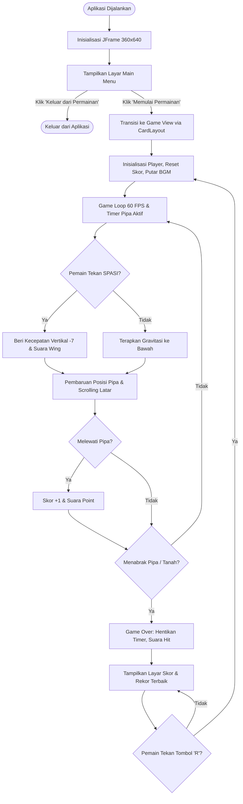

# Tugas Praktikum 6 DPBO - Java Swing GUI: Game Development (Flappy Bird)

## 📌 Janji
Saya **R Mohammad FIkry Mushoffa S** dengan NIM **2502049** mengerjakan Tugas Praktikum 6 dalam mata kuliah Desain dan Pemrograman Berorientasi Objek untuk keberkahan-Nya maka saya tidak melakukan kecurangan seperti yang telah dispesifikasikan. Aamiin.

---

## 📁 Struktur Direktori
```text
TP6DPBO2526C2/
├── FlappyBird/
│   ├── src/
│   │   ├── assets/
│   │   │   ├── background.png
│   │   │   ├── bgm.wav
│   │   │   ├── bird.png
│   │   │   ├── hit.wav
│   │   │   ├── lowerPipe.png
│   │   │   ├── point.wav
│   │   │   ├── upperPipe.png
│   │   │   └── wing.wav
│   │   ├── App.java
│   │   ├── Logic.java
│   │   ├── MainMenu.java
│   │   ├── Pipe.java
│   │   ├── Player.java
│   │   ├── Sound.java
│   │   └── View.java
│   ├── .gitignore
│   └── FlappyBird.iml
├── Dokumentasi/
│   └── VideoSaatProgramDijalankan.mp4
├── .gitattributes
├── .gitignore
└── README.md
```

---

## 🎮 Deskripsi & Desain Program
Aplikasi ini merupakan adaptasi dari game klasik **Flappy Bird** yang dikembangkan menggunakan **Java Swing GUI** dengan mematuhi prinsip-prinsip Pemrograman Berorientasi Objek (PBO), pola arsitektur *Model-View-Controller* (MVC sederhana), sistem *Game Loop* 60 FPS, serta penanganan event keyboard dan audio.

### 1. `App.java` (Main Entry Point)
- Menginisialisasi window utama (`JFrame`) dengan ukuran tepat **360 x 640** piksel.
- Menerapkan `setDefaultCloseOperation(JFrame.EXIT_ON_CLOSE)`, `setLocationRelativeTo(null)`, dan `setResizable(false)`.
- Menggunakan `CardLayout` pada panel utama (`rootPanel`) untuk memfasilitasi transisi mulus antara layar **Main Menu** dan layar permainan (**Game View**).

### 2. `MainMenu.java` (Tampilan Menu Utama)
- Merepresentasikan layar menu awal yang menyambut pemain sebelum permainan dimulai.
- Memiliki dua tombol aksi sesuai dengan spesifikasi Modul 7:
  - **Memulai Permainan**: Memulai sesi gameplay baru dan beralih ke kanvas permainan.
  - **Keluar dari Permainan**: Menutup aplikasi (`System.exit(0)`).
- Menampilkan judul game, animasi melayang (*bobbing*) karakter burung, rekor skor tertinggi (*High Score*), dan petunjuk kontrol.

### 3. `Logic.java` (Controller & Game Engine)
- Mengimplementasikan `ActionListener` untuk deteksi tick *Game Loop* (60 FPS) dan `KeyListener` untuk input keyboard pemain.
- Mengelola status permainan: berjalan (*in-game*), skor real-time, skor terbaik, dan status *Game Over*.
- Menjalankan timer `pipesCooldown` (interval ~1.7 detik) untuk pemunculan sepasang rintangan pipa secara acak (*random placement*).
- Memproses fisika gravitasi bertahap, pembatasan kecepatan jatuh (*terminal velocity cap*), serta rotasi aerodinamis burung.
- Mendeteksi tabrakan presisi (*AABB Collision Detection*) dengan padding hitbox yang adil.
- Menghitung skor (+1) setiap kali pemain berhasil melewati pipa atas.
- Mengatur pemutaran efek suara (SFX) dan musik latar (BGM).

### 4. `View.java` (View & Graphic Rendering)
- Merupakan kanvas `JPanel` tempat seluruh elemen visual digambar ulang setiap frame (`paintComponent` & `draw`).
- Menerapkan grafis berkualitas tinggi dengan *Anti-Aliasing* (`RenderingHints.KEY_ANTIALIASING`).
- Menggambar latar belakang dinamis (*dual-segment infinite horizontal loop*) dengan pendaran cahaya matahari hangat (*Sun Glow*) dan awan-awan melayang (*drifting clouds*).
- Menggambar rintangan pipa lengkap dengan bayangan (*drop shadow*) halus.
- Menggambar tanah bawah (*infinite ground*) yang bergerak sinkron dengan kecepatan pipa.
- Menggambar karakter burung dengan sudut rotasi dinamis serta efek elastisitas (*squash & stretch*).
- Menampilkan HUD skor real-time menggunakan komponen **`JLabel`** di bagian atas layar.
- Menampilkan layar **Game Over** yang bersih dan informatif: menampilkan judul, Skor Akhir, Skor Terbaik, serta instruksi tegas **Tekan "R" untuk Restart**.

### 5. `Player.java` (Model Karakter)
- Kelas model yang merepresentasikan karakter burung.
- Menyimpan koordinat posisi (`posX`, `posY`), dimensi (`width`, `height`), gambar sprite (`image`), kecepatan vertikal (`velocityY`), sudut rotasi, dan skala animasi (*squash & stretch*).

### 6. `Pipe.java` (Model Rintangan)
- Kelas model yang merepresentasikan rintangan pipa (atas atau bawah).
- Menyimpan koordinat posisi (`posX`, `posY`), dimensi (`width`, `height`), gambar sprite (`image`), kecepatan horizontal (`velocityX`), dan status apakah pipa telah dilewati (`passed`).

### 7. `Sound.java` (Audio Engine)
- Mengelola pemutaran audio secara *asynchronous* menggunakan `javax.sound.sampled` API.
- Memutar Background Music (BGM) secara berulang (*continuous loop*).
- Mendukung pemutaran efek suara instan dengan sistem *preloaded byte cache*:
  - `wing.wav`: Suara kepakan sayap saat melompat.
  - `point.wav`: Suara saat berhasil menambah skor (+1).
  - `hit.wav`: Suara benturan saat menabrak rintangan atau terjatuh ke tanah.

---

## 🕹️ Kontrol Permainan
| Tombol Input | Aksi / Fungsi |
| :--- | :--- |
| **Spasi (Spacebar)** | Membuat burung melompat / terbang ke atas melawan gravitasi |
| **R** | Memulai ulang permainan (*restart*) dari awal (hanya aktif saat *Game Over*) |
| **Klik "Memulai Permainan"** | Memulai permainan dari Menu Utama |
| **Klik "Keluar dari Permainan"** | Menutup dan mengakhiri aplikasi |

---

## 🔄 Alur Program (Game Flow)



1. **Inisialisasi Awal**:
   `App.java` membuka window `JFrame` berukuran 360x640 piksel dan langsung menampilkan `MainMenu`.
2. **Menu Utama**:
   Pemain memilih antara tombol *Memulai Permainan* atau *Keluar dari Permainan*. Saat tombol mulai ditekan, `CardLayout` mengganti tampilan ke `View` dan game loop dijalankan.
3. **Gameplay**:
   - Game loop berjalan pada kecepatan 60 frame per detik, memperbarui pergerakan latar belakang, tanah, dan pipa.
   - Pipa baru muncul dari kanan setiap 1.7 detik dengan variasi celah vertikal acak.
   - Pemain menekan tombol **SPASI** untuk mengepakkan sayap dan melawan tarikan gravitasi.
   - Melewati sepasang pipa akan menambah skor sebanyak **+1** pada `JLabel` di atas layar.
4. **Game Over & Deteksi Benturan**:
   - Jika burung menabrak pipa atau menyentuh tanah, game loop dan pemunculan pipa seketika dihentikan.
   - Efek suara benturan diputar dan skor terbaik diperbarui jika pemain melampaui rekor sebelumnya.
5. **Restart Permainan**:
   - Pemain menekan tombol **"R"** pada keyboard untuk mereset posisi burung, mengosongkan rintangan, mereset skor, dan memulai kembali jalannya permainan.

---

## 📹 Dokumentasi Program
Seluruh rekaman demonstrasi jalannya program (mulai dari Main Menu, gameplay lompat dan melewati rintangan, perolehan skor, audio BGM/SFX, Game Over, hingga fungsi restart) dapat disaksikan langsung melalui file video berikut:

- 🎬 **[`Dokumentasi/VideoSaatProgramDijalankan.mp4`](Dokumentasi/VideoSaatProgramDijalankan.mp4)**
